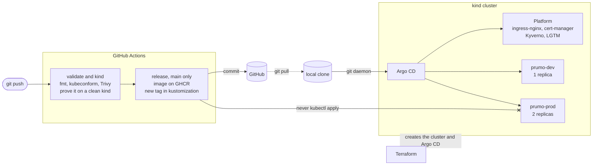

<p align="center">
  
</p>

# Prumo

A local Kubernetes platform you can stand up on a laptop to see how an application behaves in a cluster that already looks like a cloud one: GitOps, admission policies, TLS, and observability.

| Infrastructure    |      |
| ----------------- | ----------------------------------------------------------------------------------------------------------------------------------------------------------------------------------------------------------------------------------------------------------------------------------------------------------------------------------------------------------------------------------------------------------------------------------------------------------------------------------------------- |
| Build and security |      |
| Observability     |       |

`make up` brings up a kind cluster with the delivery path already wired, from commit to `dev` and `prod`, plus metrics, logs, traces, and an alert. The API in [`apps/prumo`](apps/prumo) is a 75-line Python example. Another service joins the same cluster by following [guide 9](docs/guide/09-another-application.md).

Terraform creates the cluster and installs Argo CD. From then on, Argo CD is the one that applies, reading Git. GitHub Actions builds the image, runs Trivy, and writes the new tag back to Git. The runner never runs `kubectl apply` on a live cluster, and a file that was not committed never reaches the cluster.



Argo CD reads a `git daemon` inside the cluster that serves this clone's `.git`. Any clone comes up without GitHub, and a local commit reaches the cluster. The cluster does not read GitHub ([ADR 0006](docs/adr/0006-argocd-reads-local-git.md)).

## Bring it up

You need:

- Docker Desktop with at least 8 GB of memory
- `make`, `terraform`, `kind`, `kubectl`, `helm`, `kustomize`, `sops`, and `age` on `PATH`
- ports 8080 and 8443 free
- this line in your hosts file (`C:\Windows\System32\drivers\etc\hosts` on Windows, `/etc/hosts` on Linux and macOS):

```text
127.0.0.1 dev.prumo.test prod.prumo.test argocd.prumo.test grafana.prumo.test
```

On Windows, `make` uses the bash that ships with Git for Windows.

```bash
make up       # build the images, create the cluster, install Argo CD
make status   # Applications and Pods
make check    # /healthz on dev and prod
make down     # tear it all down, cluster included
```

`make up` returns when Argo CD is up. Applications keep syncing after that. kube-prometheus-stack is the slowest.

Ports 8080 and 8443 bind to `127.0.0.1`. Another machine on the network cannot reach Grafana or Argo CD.

| Address | What it is | Login |
|---|---|---|
| http://dev.prumo.test:8080 | API on `dev`, one replica | |
| http://prod.prumo.test:8080 | API on `prod`, two replicas | |
| http://argocd.prumo.test:8080 | Argo CD | `admin`, password from `make argocd-password` |
| http://grafana.prumo.test:8080 | Grafana, opens on the `Prumo` dashboard | `admin` / `prumo-dev-admin` |

The Grafana password is encrypted with SOPS. The key that opens the file is committed in [`keys/`](keys) so `make up` works on a fresh clone. It is only for this lab ([ADR 0004](docs/adr/0004-sops-with-a-dev-key.md)).

## Walkthrough

The [demo](docs/demo.md) takes about five minutes. It opens both environments, shows the Applications `Synced` in Argo CD, and tries to apply a Pod that Kyverno rejects. Then it scales `prumo-prod` down so the `PrumoDown` alert fires, and follows a request from a Loki log line to the Tempo trace.

## What runs in the cluster

Terraform creates one Application, `root`, which reads [`platform/apps/`](platform/apps). Each file in that directory is another Application:

| Application | What it does |
|---|---|
| `ingress-nginx` | Takes traffic on port 8080, routes by `Host`, and starts a trace per request |
| `cert-manager` and `certs` | Issue the `*.prumo.test` certificate from a local CA |
| `kyverno` and `policies` | Reject a Pod with no `limits`, a `latest` tag, or root in `prumo-dev` and `prumo-prod` |
| `kube-prometheus-stack` | Prometheus, Alertmanager, and Grafana |
| `mimir` | Keeps metrics for 7 days |
| `loki` | Keeps logs for 72 hours |
| `tempo` | Keeps traces for 24 hours |
| `alloy` | Ships Pod stdout to Loki and ingress traces to Tempo |
| `observability` | ServiceMonitor, `PrumoDown` alert, and the `Prumo` dashboard |
| `prumo-dev` and `prumo-prod` | The API, same image in both environments |

The API has no OpenTelemetry SDK. The trace starts at ingress-nginx, which forwards the `traceparent` header, and the API writes `trace_id` at the end of each log line. That ID is how Grafana jumps from the log to the trace. [Guide 8](docs/guide/08-observability.md) walks the full path.

## CI

The [`ci`](.github/workflows/ci.yml) workflow runs on every push and pull request. It checks Terraform, runs the overlays through `kubeconform`, and fails the image if Trivy finds a HIGH or CRITICAL vulnerability that already has a fix. Then it brings up a clean kind cluster, where Kyverno must reject the invalid Pod and the `dev` overlay must answer `/healthz`.

On `main`, a third job, `release`, runs after the other two pass. If `apps/prumo` changed, it publishes the image to GHCR with that tree hash as the tag and commits the tag in `kustomization.yaml`. Argo CD does the deploy. A clone does not need that image: `make up` builds it and loads it into the node ([guide 6](docs/guide/06-ci.md)).

## Repository map

```text
prumo/
├── apps/prumo/          Sample API and its Dockerfile
├── deploy/prumo/
│   ├── base/            Deployment, Service, Ingress, NetworkPolicy, Certificate
│   └── overlays/        dev (1 replica) and prod (2 replicas)
├── platform/
│   ├── root/            Chart that creates the root Application
│   ├── apps/            One Application per file: the list Argo CD reconciles
│   ├── certs/           Local ClusterIssuer
│   ├── mimir/           Monolithic Mimir, no chart
│   ├── observability/   ServiceMonitor, PrometheusRule, and dashboard
│   ├── secrets/         Grafana Secret, encrypted with SOPS
│   └── git/             git daemon image that serves this repo to Argo CD
├── policies/            Kyverno ClusterPolicies and the invalid Pod fixture
├── terraform/           The ground: kind cluster, git daemon, Argo CD, Secret
├── keys/                Development age key (read ADR 0004)
└── docs/
    ├── guide/           Study path, one tool at a time
    ├── adr/             Architecture decisions
    ├── security.md      What this lab exposes
    └── demo.md          Five-minute walkthrough
```

## Documentation

[Security](docs/security.md) says what is locked down and what is accepted on purpose.

The guide follows the order each tool shows up on the path: [Argo CD map](docs/guide/00-argocd-map.md), [container](docs/guide/01-container.md), [Kubernetes](docs/guide/02-kubernetes.md), [Kustomize](docs/guide/03-kustomize.md), [Argo CD](docs/guide/04-argocd.md), [Terraform](docs/guide/05-terraform.md), [CI](docs/guide/06-ci.md), [guardrails](docs/guide/07-guardrails.md), [observability](docs/guide/08-observability.md), and [how to put another application on the cluster](docs/guide/09-another-application.md).

The ADRs cover the choices that weigh the most:

- [0001](docs/adr/0001-kind-as-the-cluster.md): the local cluster is kind
- [0002](docs/adr/0002-terraform-only-bootstraps.md): Terraform only bootstraps, Argo CD does the rest
- [0003](docs/adr/0003-gitops-with-argocd.md): GitOps with Argo CD
- [0004](docs/adr/0004-sops-with-a-dev-key.md): SOPS with the development key in the repository
- [0005](docs/adr/0005-monolithic-lgtm.md): Loki, Tempo, and Mimir in monolithic mode, to fit in 8 GB
- [0006](docs/adr/0006-argocd-reads-local-git.md): Argo CD reads local Git only, never GitHub

## Common problems

| Symptom | Likely cause |
|---|---|
| `make up` stops with "Argo CD only reads commits" | The repository has no commit yet |
| A change does not show up in the cluster | The file was not committed |
| Pods in `monitoring` restarting or `Pending` | Docker Desktop has less than 8 GB |
| `*.prumo.test` addresses do not open | The hosts line is missing, or the port is not 8080 |

## Limits

This is not a managed Kubernetes, a secret vault, or an uptime monitor. Canary, a database, and a second cluster were left out. Loki, Tempo, and Mimir store data in `emptyDir`, so restarting the Pod wipes it. Each ADR says what would change in production.

[MIT](LICENSE) license.

Built with ❤️ and a focus on learning 📚! 🤓
