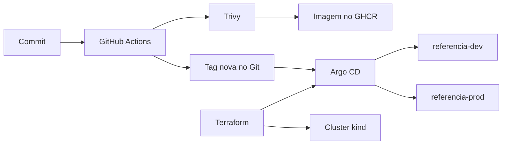

# Prumo

Portfólio de entrega. O Prumo mostra o caminho que um time usa para levar um serviço de um commit até os ambientes `dev` e `prod`. Não é um produto novo. A API em `apps/referencia` existe para esse caminho ter o que carregar.

Terraform cria o cluster e o Argo CD. O Argo CD aplica o que está no Git. GitHub Actions constrói a imagem, o Trivy escaneia, e o workflow de release grava a tag nova no Git. O runner não executa `kubectl apply` em produção.



## O que sobe

Depois de `make up`, na mesma máquina:

| Endereço | O que é |
|---|---|
| http://referencia.dev.localhost:8080 | Workload, uma réplica |
| http://referencia.prod.localhost:8080 | Workload, duas réplicas |
| http://argocd.localhost:8080 | Argo CD. Usuário `admin`, senha em `make argocd-password` |
| http://grafana.localhost:8080 | Grafana. Usuário `admin`, senha em `make grafana-password` |

O Grafana usa a senha cifrada em `platform/secrets/grafana-admin.yaml`. A chave que abre esse arquivo está no repositório de propósito. Leia [docs/adr/0004-sops-com-chave-de-desenvolvimento.md](docs/adr/0004-sops-com-chave-de-desenvolvimento.md).

## Pré-requisitos

- Docker Desktop em execução, com pelo menos 6 GB de memória para o kube-prometheus-stack
- `make`, `terraform`, `kind`, `kubectl`, `helm`, `kustomize`, `sops` e `age` no `PATH`
- As portas 8080 e 8443 livres. O HTTP fica na porta 8080. O certificado local também existe na 8443, e o ingress não redireciona o HTTP para lá.

No Windows, o `make` deste repositório usa o bash que vem com o Git for Windows.

## Subir e derrubar

```bash
make up
make check
make status
make down
```

`make up` constrói a imagem, cria o cluster e espera o Argo CD existir. As Applications seguem sincronizando depois que o comando termina. `make status` mostra o que ainda não ficou `Healthy`. A primeira sincronização do kube-prometheus-stack é a mais demorada.

O Argo CD lê commits. Um arquivo salvo e não commitado não entra no cluster.

## Como o repositório está dividido

- `terraform/` cria o cluster, o git daemon, o Argo CD e o Secret do Grafana
- `platform/apps/` é a lista de Applications que o Argo CD reconcilia
- `platform/certs/` é o emissor de certificado local
- `platform/observability/` é o ServiceMonitor, o alerta e o dashboard
- `deploy/referencia/` é a base e os overlays `dev` e `prod`
- `policies/` são as regras do Kyverno para os namespaces do workload
- `apps/referencia/` é o workload de referência
- `docs/guia/` explica cada ferramenta, na ordem em que o problema aparece
- `docs/adr/` registra as decisões
- `docs/demo.md` é o roteiro de cinco minutos

## O que isto não é

Não substitui um Kubernetes gerenciado, um cofre de segredos nem um monitor de uptime. Canary, banco e segundo cluster ficam de fora. O valor do repositório é o caminho, reproduzível com `make up`, e a separação entre quem constrói a imagem e quem aplica no cluster.
