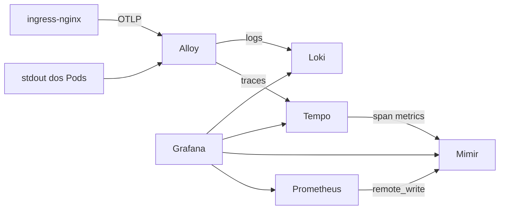

# 8. Observabilidade

## O que é

O workload já responde `/metrics`. Falta quem leia isso o tempo todo e quem avise quando o Deployment deixa de ter réplica. O kube-prometheus-stack (chart 92.14.0) instala três programas e os CRDs que os configuram:

- **Prometheus** raspa alvos HTTP no formato OpenMetrics e guarda as séries. Um alvo entra na raspagem quando existe um `ServiceMonitor` cujo selector bate com o Service.
- **Alertmanager** recebe alertas que o Prometheus disparou e agrupa, silencia ou encaminha. Aqui ele só guarda. Não há receiver de Slack ou e-mail.
- **Grafana** lê o Prometheus e desenha painéis. O login não é senha gerada pelo chart: o values aponta `existingSecret: grafana-admin` e as chaves `admin-user` / `admin-password`.

Os CRDs são do prometheus-operator: `ServiceMonitor`, `PrometheusRule`, `Prometheus`. O operator traduz isso em configuração do Prometheus. Você não edita o `prometheus.yml` na mão.

## O que foi desligado

O kind não expõe etcd, scheduler, controller-manager nem kube-proxy para raspagem. Os jobs correspondentes do chart estão desligados. Sem isso o Prometheus fica Degraded por alvos que nunca vão existir neste nó.

`*NilUsesHelmValues: false` nos selectors do Prometheus faz o operator aceitar ServiceMonitor e PrometheusRule de qualquer namespace, não só os que carregam o label do Helm. O monitor do workload mora no namespace `monitoring` e seleciona Services em `prumo-dev` e `prumo-prod`.

## Os três objetos nossos

Em [platform/observability](../../platform/observability), aplicados pela Application `observability` depois do chart:

**ServiceMonitor `prumo`.** Aponta para Services com `app.kubernetes.io/name: prumo` nos dois namespaces. Lê a porta de nome `http`, caminho `/metrics`, a cada 30s. O Prometheus guarda a série `prumo_up`. Com o cluster no ar há três séries: uma do Pod de dev e duas dos Pods de prod, todas com valor `1`.

**PrometheusRule `prumo`.** Uma regra, `PrumoForaDoAr`:

```promql
kube_deployment_status_replicas_available{namespace=~"prumo-.+", deployment="prumo"} == 0
```

`for: 1m` exige que a expressão continue verdadeira por um minuto antes de virar alerta. Isso evita disparo num restart de segundos. A métrica vem do kube-state-metrics, que lê a API do Kubernetes, não o `/metrics` do workload. Réplica disponível em zero é "o Deployment não tem Pod Ready". O processo pode estar no ar e ainda assim a probe ter falhado.

**Dashboard `Prumo`.** Um ConfigMap com o label `grafana_dashboard: "1"`. Um sidecar no Pod do Grafana copia esse JSON para `/tmp/dashboards/prumo.json` e recarrega a lista. O `grafana.ini` aponta a página inicial para esse arquivo e redireciona `/` para `/d/prumo/prumo`. Sem isso o Grafana 13 abre a tela "Welcome to Grafana", que não mostra painel nenhum, embora os dashboards existam no menu Dashboards.

Os painéis leem o datasource `prometheus`:

- réplicas disponíveis e `prumo_up`, por namespace
- `PrumoForaDoAr`: `ok` enquanto a regra não está `firing`, `disparado` quando está
- pedidos por segundo, a partir de `prumo_requests_total` (o `/metrics` não entra na conta)
- CPU e memória do container `app` nos namespaces `prumo-*`
- logs do container `app`, lidos do Loki

O datasource Prometheus leva `manageAlerts: true`. A regra do Prometheus passa a aparecer em Alerting, não só dentro do Prometheus. Com o workload no ar ela fica normal, não disparada.

## Loki, Tempo e Mimir

O Grafana sozinho só desenha. A stack LGTM é o Grafana mais três bancos, um para cada sinal:

- **Loki** guarda logs. Indexa só os labels (`namespace`, `pod`, `container`, `app`), não o texto. Buscar por um trecho da linha é filtro sobre os chunks do intervalo pedido.
- **Tempo** guarda traces. Um trace é a árvore de spans de um pedido. O Tempo acha um trace pelo ID sem índice nenhum.
- **Mimir** guarda métricas por mais tempo que o Prometheus. O Prometheus continua raspando e avaliando a regra `PrumoForaDoAr`. Ele só passa a enviar cada amostra também para o Mimir, por `remote_write`.

Os três rodam como binário único (monolítico), uma réplica, com disco `emptyDir`. A [ADR 0005](../adr/0005-lgtm-monolitico.md) diz por quê e o que isso custa.

Falta quem leve os logs e os traces até lá. Esse é o **Grafana Alloy**, um coletor:

- lê o stdout de todos os containers pela API do Kubernetes (o mesmo caminho do `kubectl logs`) e grava no Loki
- recebe traces em OTLP nas portas 4317 (gRPC) e 4318 (HTTP) e repassa para o Tempo



### De onde vem o trace

O workload não tem SDK de OpenTelemetry. O trace nasce no ingress-nginx: com `enable-opentelemetry: "true"`, cada pedido que passa pelo proxy vira um span e segue para o Alloy. O nginx também injeta o cabeçalho `traceparent` (W3C) no pedido que entrega ao Pod.

O workload não cria span. Ele lê o `traceparent` e escreve o `trace_id` no fim da linha de log. O log de acesso do ingress-nginx também termina com `trace_id=...`. As duas linhas do mesmo pedido carregam o mesmo ID. A probe do kubelet não passa pelo ingress, então `/healthz` aparece no log sem `trace_id`.

### Como os sinais se ligam no Grafana

Os datasources estão no values do kube-prometheus-stack, com uid fixo: `loki`, `tempo`, `mimir`.

- **Log para trace.** O datasource Loki tem um campo derivado que reconhece `trace_id=<32 hex>` na linha. Abra a linha no painel de logs: o campo `trace_id` traz o link "Abrir no Tempo".
- **Trace para log.** No trace aberto, o botão de logs do span consulta o Loki por `{namespace=~"prumo-.+|ingress-nginx"} |= "<trace id>"`. Aparecem a linha do ingress e a linha do workload.
- **Trace para métrica.** O metrics-generator do Tempo calcula a partir dos spans `traces_spanmetrics_calls_total`, a latência e o grafo de serviços, e grava no Mimir. A aba Service Graph do Tempo lê dali.

O datasource `Prometheus` continua o padrão e o dashboard `Prumo` continua lendo dele, com 6h de retenção. O datasource `Mimir` tem as mesmas séries com 7 dias, para olhar mais para trás em Explore.

## Onde abrir

Grafana: `http://grafana.prumo.test:8080`. Usuário `admin`, senha `prumo-dev-admin`. A primeira tela é o dashboard `Prumo`. Os dashboards do próprio Kubernetes (CPU do nó, pods, kubelet) continuam no menu Dashboards, com título `Kubernetes / ...`.

Loki, Tempo e Mimir não têm Ingress. Quem fala com eles é o Grafana, por dentro do cluster. Para consultar sem o Grafana:

```bash
kubectl -n monitoring port-forward svc/loki 3100:3100
kubectl -n monitoring port-forward svc/tempo 3200:3200
kubectl -n monitoring port-forward svc/mimir 9009:9009
```

O Mimir responde a API do Prometheus em `/prometheus`, por exemplo `http://localhost:9009/prometheus/api/v1/query?query=up`.

O [roteiro](../demo.md) escala `prumo-prod` para 0 e espera um minuto. O card do alerta vira `disparado` e a regra aparece em Alerting. O selfHeal devolve as 2 réplicas no ciclo seguinte.
