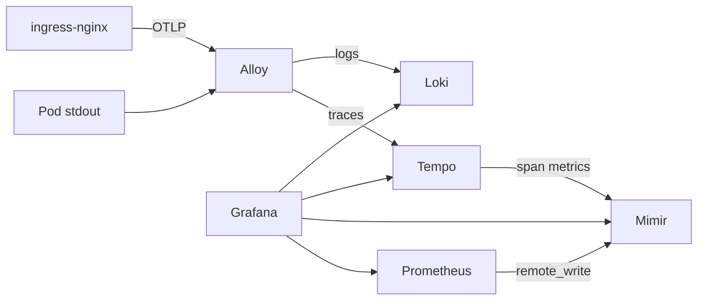

# 8. Observability

## Profiles

`make up` (and `PROFILE=lite`) installs Prometheus, Grafana, Alertmanager, the ServiceMonitor, the `PrumoDown` rule, and the `Prumo` dashboard. That is enough to see replicas and process health.

`make up PROFILE=full` or `make observe-full` also installs Loki, Tempo, Mimir, and Alloy, plus the Loki/Tempo/Mimir datasources, Prometheus `remote_write`, ingress OpenTelemetry, and the logs panel on the dashboard.

## What it is

The workload already answers `/metrics`. What was missing is something that reads that all the time and something that fires when the Deployment has no replica. kube-prometheus-stack installs three programs and the CRDs that configure them:

- **Prometheus** scrapes HTTP targets in OpenMetrics format and stores the series. A target enters the scrape when a `ServiceMonitor` selector matches the Service.
- **Alertmanager** receives alerts Prometheus fired and groups, silences, or forwards them. Here it only stores. There is no Slack or email receiver.
- **Grafana** reads Prometheus and draws panels. Login is not a password generated by the chart: the values point at `existingSecret: grafana-admin` and the `admin-user` / `admin-password` keys.

The CRDs belong to prometheus-operator: `ServiceMonitor`, `PrometheusRule`, `Prometheus`. The operator turns that into Prometheus config. You do not edit `prometheus.yml` by hand.

## What was turned off

kind does not expose etcd, the scheduler, the controller-manager, or kube-proxy for scraping. The matching jobs in the chart are off. Without that, Prometheus stays Degraded on targets that will never exist on this node.

`*NilUsesHelmValues: false` on the Prometheus selectors makes the operator accept a ServiceMonitor and a PrometheusRule from any namespace, not only those that carry the Helm label. The workload monitor lives in the `monitoring` namespace and selects Services in `prumo-dev` and `prumo-prod`.

## The three objects that are ours

In [platform/observability](../../platform/observability), applied by the `observability` Application after the chart. Shared objects live in `base/`. The dashboard is `lite/dashboard.yaml` or `full/dashboard.yaml`.

**ServiceMonitor `prumo`.** Points at Services with `app.kubernetes.io/name: prumo` in both namespaces. Reads the port named `http`, path `/metrics`, every 30s. Prometheus stores the `prumo_up` series. With the cluster up there are three series: one from the dev Pod and two from the prod Pods, all with value `1`.

**PrometheusRule `prumo`.** One rule, `PrumoDown`:

```promql
kube_deployment_status_replicas_available{namespace=~"prumo-.+", deployment="prumo"} == 0
```

`for: 1m` requires the expression to stay true for a minute before it becomes an alert. That avoids a fire on a restart of a few seconds. The metric comes from kube-state-metrics, which reads the Kubernetes API, not the workload `/metrics`. Available replicas at zero means "the Deployment has no Ready Pod". The process can be up and the probe can still have failed.

**Dashboard `Prumo`.** A ConfigMap with the label `grafana_dashboard: "1"`. A sidecar in the Grafana Pod copies that JSON to `/tmp/dashboards/prumo.json` and reloads the list. `grafana.ini` points the home page at that file and redirects `/` to `/d/prumo/prumo`. Without that, Grafana opens the "Welcome to Grafana" screen, which shows no panel, even though the dashboards exist under Dashboards. The `lite` dashboard stops at Prometheus panels. The logs panel is on `full`.

The panels on both profiles read the `prometheus` datasource:

- available replicas and `prumo_up`, by namespace
- `PrumoDown`: `ok` while the rule is not `firing`, `firing` when it is
- requests per second, from `prumo_requests_total` (the `/metrics` path is not counted)
- CPU and memory of the `app` container in the `prumo-*` namespaces

On `full` only: logs from the `app` container, read from Loki.

The Prometheus datasource has `manageAlerts: true`. The Prometheus rule then shows up under Alerting, not only inside Prometheus. With the workload up it stays normal, not firing.

## Loki, Tempo, and Mimir (`full` only)

These three are off on `lite`. Grafana on its own only draws. The LGTM stack is Grafana plus three stores, one per signal:

- **Loki** stores logs. It indexes only the labels (`namespace`, `pod`, `container`, `app`), not the text. Searching for a snippet of the line is a filter over the chunks in the requested window.
- **Tempo** stores traces. A trace is the span tree of one request. Tempo finds a trace by ID with no index at all.
- **Mimir** stores metrics for longer than Prometheus. Prometheus still scrapes and evaluates the `PrumoDown` rule. It also sends every sample to Mimir through `remote_write`.

All three run as a single binary (monolithic), one replica, on `emptyDir`. [ADR 0005](../adr/0005-monolithic-lgtm.md) says why and what that costs.

Something still has to carry logs and traces there. That is **Grafana Alloy**, a collector:

- reads stdout from every container through the Kubernetes API (the same path as `kubectl logs`) and writes to Loki
- receives traces in OTLP on ports 4317 (gRPC) and 4318 (HTTP) and forwards them to Tempo



### Where the trace comes from

The workload has no OpenTelemetry SDK. The trace starts at ingress-nginx: with `enable-opentelemetry: "true"`, each request that passes the proxy becomes a span and goes to Alloy. nginx also injects the W3C `traceparent` header on the request it delivers to the Pod.

The workload does not create a span. It reads `traceparent` and writes `trace_id` at the end of the log line. The ingress-nginx access log also ends with `trace_id=...`. Both lines from the same request carry the same ID. The kubelet probe does not go through ingress, so `/healthz` shows up in the log with no `trace_id`.

### How the signals link in Grafana

On `full`, the extra datasources are in the kube-prometheus-stack values, with fixed uids: `loki`, `tempo`, `mimir`. `lite` only has Prometheus and Alertmanager.

- **Log to trace.** The Loki datasource has a derived field that recognizes `trace_id=<32 hex>` on the line. Open the line in the logs panel: the `trace_id` field has the "Open in Tempo" link.
- **Trace to log.** On the open trace, the span logs button queries Loki with `{namespace=~"prumo-.+|ingress-nginx"} |= "<trace id>"`. The ingress line and the workload line both appear.
- **Trace to metric.** Tempo's metrics-generator computes `traces_spanmetrics_calls_total`, latency, and the service graph from the spans, and writes to Mimir. Tempo's Service Graph tab reads from there.

The `Prometheus` datasource stays the default and the `Prumo` dashboard still reads from it, with 6h retention. The `Mimir` datasource has the same series with 7 days, for looking further back in Explore.

## Where to open it

Grafana: `http://grafana.prumo.test:8080`. User `admin`, password `prumo-dev-admin`. The first screen is the `Prumo` dashboard. The Kubernetes dashboards themselves (node CPU, pods, kubelet) stay under Dashboards, titled `Kubernetes / ...`.

On `full`, Loki, Tempo, and Mimir have no Ingress. Grafana talks to them from inside the cluster. To query without Grafana:

```bash
kubectl -n monitoring port-forward svc/loki 3100:3100
kubectl -n monitoring port-forward svc/tempo 3200:3200
kubectl -n monitoring port-forward svc/mimir 9009:9009
```

Mimir answers the Prometheus API at `/prometheus`, for example `http://localhost:9009/prometheus/api/v1/query?query=up`.

The [walkthrough](../demo.md) scales `prumo-prod` to 0 and waits a minute. The alert card turns to `firing` and the rule shows up under Alerting. selfHeal brings the 2 replicas back on the next cycle. That step works on `lite`. The log-to-trace step needs `full`.

`lite` is not a small cluster. A measured `make up` put the kind node at about 5.3 GiB; `full` at about 6.5 GiB. Give Docker Desktop 8 GB for either profile.
